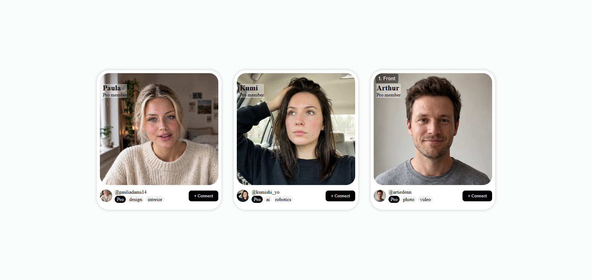

# Interactive Profile Cards

🔗 **[View the Live Demo Here](https://tahasoumbate.github.io/Interactive-Profile-Cards/)**

## 📸 Preview

# Interactive Profile Cards

A set of three distinct profile cards with custom backgrounds, tags, and interactive elements.

## 🚀 Features
- **Card Layout:** Clean, rounded cards with soft shadows and distinct pastel background colors.
- **Responsive Images:** Uses `object-fit: cover` to ensure images fit perfectly without stretching.
- **Flexbox Alignment:** The bottom section is perfectly aligned using Flexbox to separate the user info (left) and the Connect button (right).

## 🛠️ Technologies Used
- HTML5
- CSS3 (Flexbox, Border-radius, Object-fit)

## 🧠 What I Learned
- How to structure a complex UI component using Flexbox (`flex-direction: column` for the card, `row` for the footer).
- How to style and align small UI elements like tags and avatar images.
- The importance of removing hardcoded heights/widths and letting content dictate layout.

## 📂 How to View
Simply open the `index.html` file in your browser.